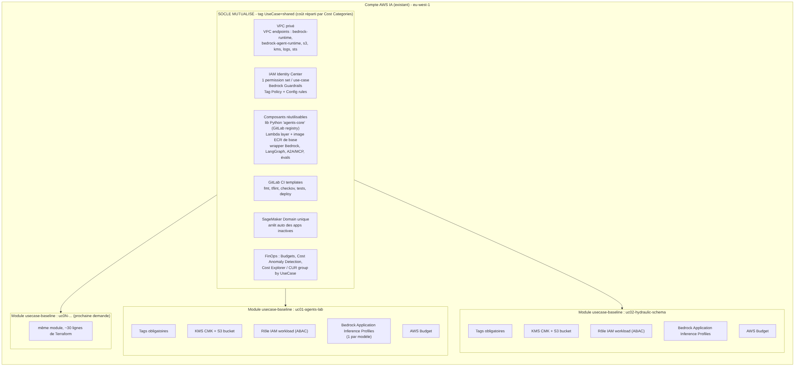

# Plateforme IA AWS multi-use-cases – architecture, tagging et chiffrage

**Contexte.** Un compte AWS héberge déjà deux projets (`trends-analysis` : RAG, `langgraph-agents` : LangGraph).
De nouvelles demandes RAG / agents arrivent sur le même compte, portées par des métiers différents qu'il faut
pouvoir **refacturer séparément**.

> Les deux repos existants n'étaient pas accessibles depuis cette session : l'architecture reprend le
> pattern « Lambda + LangGraph + Bedrock + S3 » décrit, et reste à aligner avec leur code.

| # | Demande | Identifiant proposé |
|---|---|---|
| 1 | Prototypage IA : multi-agents (A2A / MCP), world models, scouting d'appels d'offres | `uc01-agents-lab` |
| 2 | Génération de schéma hydraulique : fiche de besoin → JSON → CAO, puis RAG / GraphRAG | `uc02-hydraulic-schema` |

Sommaire : [1. Socle + enveloppes](#1-optimiser--un-socle-mutualisé-et-une-enveloppe-par-use-case) ·
[2. Besoin 1](#2-besoin-1--uc01-agents-lab) · [3. Besoin 2](#3-besoin-2--uc02-hydraulic-schema) ·
[4. Tagging et refacturation](#4-tagging-et-refacturation) · [5. Chiffrage](#5-chiffrage-mensuel-estimé) ·
[6. Sécurité](#6-sécurité-devsecops) · [7. Plan](#7-plan-de-mise-en-œuvre)

---

## 1. Optimiser : un socle mutualisé et une enveloppe par use-case



Chaque nouvelle demande = **un bloc `module "usecase-baseline"`** (≈ 30 lignes, voir `terraform/live/main.tf`).
Le module crée toujours la même enveloppe : tags, CMK KMS, bucket S3, rôle IAM ABAC,
**Application Inference Profiles Bedrock** et budget. Les services propres au besoin (Step Functions, KB,
Neptune…) se branchent dessus et héritent des tags via `module.<uc>.tags`.

| Mutualisé (construit une fois) | Isolé par use-case |
|---|---|
| VPC + VPC endpoints (réutiliser ceux des projets existants) | Clé KMS, bucket S3, logs |
| Guardrails Bedrock, Tag Policy, Config rules | Rôle IAM workload (ABAC `UseCase`) |
| Lib interne `agents-core` (wrapper Bedrock, graphes LangGraph génériques, adaptateurs A2A/MCP, harness d'éval) | Inference profiles Bedrock (coût Bedrock ventilé) |
| Templates GitLab CI (fmt, tflint, checkov, tests, deploy) | Knowledge Base, base graphe, DynamoDB |
| Domaine SageMaker unique, 1 user profile / use-case | Budget + alertes |
| Dashboards FinOps | Permission set IAM Identity Center |

Gain : un nouveau besoin se déploie en jours au lieu de semaines, les contrôles sécurité sont identiques
partout, et le coût du socle est réparti au lieu d'être dupliqué.

---

## 2. Besoin 1 – `uc01-agents-lab`


| Brique | Choix | Remarque |
|---|---|---|
| LLM | **Claude Haiku via Bedrock** (Converse API) + 1-2 modèles en comparaison | modèle = paramètre (ARN d'inference profile), pas du code |
| Orchestration agents | **LangGraph dans Lambda**, un superviseur + agents spécialisés | réutilise le pattern `langgraph-agents` |
| Workflows longs / tests | **Step Functions** autour des Lambda | dépasse la limite des 15 min, retries, campagnes d'évals |
| Communication | **A2A** entre agents, **MCP** pour les outils | candidat à mettre dans `agents-core` |
| Mémoire / état | **DynamoDB** (checkpointer LangGraph) | on-demand, quasi gratuit à petite échelle |
| Déclencheurs | EventBridge Scheduler (scouting quotidien), API Gateway privée, GitLab CI | |
| Évaluation | Lambda Évaluateur (LLM-as-judge + métriques), résultats S3 | rejouable en CI = « tests serverless » |
| World models | **SageMaker Studio** + Training/Processing Jobs **Spot**, MLflow managé | GPU à la demande uniquement, pas d'instance permanente |
| Données | HuggingFace / benchmarks / appels d'offres publics → S3 | `DataClassification=public` |

Option à évaluer plus tard : **Bedrock AgentCore** (runtime, mémoire et gateway MCP managés) si
les limites de Lambda gênent (sessions longues, streaming).

---

## 3. Besoin 2 – `uc02-hydraulic-schema`


Le pipeline Step Functions :
1. **Valide la fiche de besoin** (JSON Schema : puissance, fluide, heures de fonctionnement…).
2. **Récupère** les règles hydrauliques et des projets similaires (Knowledge Base).
3. **Génère le schéma JSON** avec N modèles en parallèle (`Map`), en sortie structurée (tool use) pour
   garantir un JSON parsable.
4. **Contrôle les règles métier** en Python déterministe (pas de LLM ici : c'est la vérité terrain).
5. **Boucle de correction** : les violations sont renvoyées au LLM, 3 itérations maximum.
6. **Convertit en CAO** : DXF via `ezdxf` dans une Lambda conteneur (convertisseur isolé, remplaçable
   si un autre format est exigé).
7. **Score comparatif** par modèle : % de règles respectées, nb d'itérations, coût, latence → S3.

| Besoin exprimé | Proposition | Pourquoi |
|---|---|---|
| Plusieurs modèles Bedrock | 1 inference profile par modèle (Sonnet, Haiku, Nova…) | comparaison objective + coût par modèle visible |
| Environnement Python | SageMaker Notebook / Studio dans le domaine partagé, VPC sans internet | accès privé à Bedrock, S3, Neptune |
| Stockage | S3 `uc02` : `input/`, `corpus/`, `output/` | une seule CMK, un seul bucket |
| RAG | Bedrock Knowledge Bases, vecteurs **S3 Vectors** en phase 1 | évite le coût plancher d'OpenSearch Serverless (≈ 175–350 $/mois) |
| Graphe + GraphRAG | **Neptune Analytics** (GraphRAG natif des Knowledge Bases) en phase 2 | **Neptune Database** seulement si un vrai besoin transactionnel apparaît |

**Phasage** : Phase 1 = fiche + règles → JSON → DXF, sans graphe (valide la faisabilité au moindre coût).
Phase 2 = ingestion de l'historique projets + GraphRAG sur Neptune Analytics.

---

## 4. Tagging et refacturation

### Taxonomie (imposée par le module, validée par Terraform)

| Tag | Exemple | Rôle |
|---|---|---|
| `UseCase` | `uc02-hydraulic-schema` | **clé de refacturation** + ABAC IAM/KMS |
| `BusinessUnit` | entité métier | à qui on refacture |
| `CostCenter` | centre de coût | imputation comptable |
| `Owner` | prenom.nom | contact |
| `Environment` | `dev` / `test` / `prod` | |
| `DataClassification` | `public` → `internal` | passage aux données ENGIE = changement contrôlé |
| `Phase` | `prototype` / `mvp` / `run` | |
| `ExpiryDate` | `2027-06-30` | nettoyage des prototypes oubliés |
| `ManagedBy` | `terraform` | |

### Ce qui rend la refacturation réellement exploitable

1. **Activer `UseCase`, `BusinessUnit`, `CostCenter` comme *cost allocation tags*** (Billing → Cost allocation
   tags). Effet sous ~24 h, **non rétroactif** : à faire avant de démarrer.
2. **Bedrock : passer par les Application Inference Profiles tagués.** Un appel Bedrock fait avec un
   `modelId` brut n'est pas attribuable à un use-case. Le code appelle l'ARN du profil
   (`output inference_profile_arns`) ; la politique IAM du module **interdit** d'appeler un modèle autrement.
3. **Coûts partagés** (VPC endpoints, Config, CloudWatch du socle) taggés `UseCase=shared`, puis répartis via
   **AWS Cost Categories – split charge rules** (proportionnel à la conso de chaque use-case ou fixe).
4. **Un AWS Budget par use-case** (alertes 80 % réel / 100 % prévisionnel) + **Cost Anomaly Detection** sur la
   dimension `UseCase`.
5. **Les tags sont imposés** : Tag Policy (Organizations) + règle Config `required-tags`, et un job de CI qui
   refuse un `terraform plan` créant une ressource sans `UseCase`.
6. Points d'attention : vérifier la propagation des tags SageMaker (domaine → user profile → apps/jobs)
   et taguer explicitement les Training Jobs ; les transferts de données et certains frais
   (support, taxes) ne sont pas taggables et restent dans `shared`.

Requête de suivi type (CUR 2.0 / Athena) :
```sql
SELECT resource_tags['user_use_case'] AS use_case,
       product['product_name']        AS service,
       ROUND(SUM(line_item_unblended_cost), 2) AS cost_usd
FROM   cur2
WHERE  billing_period = '2026-10'
GROUP  BY 1, 2
ORDER  BY 1, 3 DESC;
```

---

## 5. Chiffrage mensuel estimé

> Ordres de grandeur sur tarifs publics on-demand (USD, HT), à recalculer avec l'AWS Pricing Calculator
> pour eu-west-1 et les modèles réellement ouverts sur le compte. Hypothèses de volume indiquées : c'est elles
> qu'il faut faire valider par chaque métier.
> Tarifs utilisés : Haiku ≈ 1 $ / 5 $ par M tokens (in/out), Sonnet ≈ 3 $ / 15 $, Nova Pro ≈ 0,8 $ / 3,2 $.

### Socle mutualisé (`UseCase=shared`, réparti)
| Poste | Hypothèse | $/mois approx. |
|---|---|---|
| VPC interface endpoints | 5 endpoints × 2 AZ (0 si ceux des projets existants sont réutilisés) | 80 – 90 |
| Config, CloudWatch, KMS socle | | 10 – 20 |
| **Total** | | **≈ 90 – 110** |

### `uc01-agents-lab`
| Poste | Hypothèse | $/mois approx. |
|---|---|---|
| Bedrock Haiku – scouting | 100 AO/jour × 4 appels agents × (4k in + 0,8k out) | ≈ 100 |
| Bedrock – évals / comparaison | 500 cas/mois × 2 modèles + juge | 20 – 40 |
| Lambda, Step Functions, DynamoDB, API GW | faible volume | < 10 |
| S3 | 50 Go | ≈ 2 |
| SageMaker Studio CPU | ml.t3.medium, 80 h | ≈ 5 |
| GPU world models | ml.g5.xlarge, 40 h (Spot : −50 à −70 %) | 25 – 60 |
| KMS, logs | | ≈ 5 |
| **Total** | | **≈ 170 – 230** |

### `uc02-hydraulic-schema`
| Poste | Hypothèse | $/mois approx. |
|---|---|---|
| Bedrock – génération | 300 essais/mois × 3 modèles × 1,5 itération × (12k in + 3k out) ≈ 0,19 $/essai | ≈ 60 |
| Knowledge Base + S3 Vectors + embeddings | corpus < 10 Go | < 10 |
| SageMaker Notebook | ml.t3.medium – ml.m5.large, 160 h | 10 – 20 |
| Lambda (dont conteneur DXF), Step Functions, S3 | | < 10 |
| KMS, logs | | ≈ 5 |
| **Total phase 1** | | **≈ 90 – 110** |
| Neptune Analytics (phase 2) | plus petite capacité ≈ 0,5 $/h : 24/7 ≈ 350 $ ; heures ouvrées (supprimer / restaurer depuis snapshot) ≈ 90 $ | 90 – 350 |
| Ingestion GraphRAG (extraction d'entités par LLM) | ponctuelle, selon taille du corpus | 10 – 50 / ingestion |
| **Total phase 2** | | **≈ 200 – 500** |

Les budgets du module (`monthly_budget_usd`) sont posés à 300 $ (uc01) et 400 $ (uc02) : à ajuster après
validation des hypothèses.

**Leviers d'optimisation** : Haiku par défaut et Sonnet seulement en comparaison ; *prompt caching* sur
les longs blocs de règles (jusqu'à −90 % sur les tokens d'entrée mis en cache) ; Batch inference Bedrock
(−50 %) pour les campagnes d'éval non urgentes ; `max_tokens` borné ; notebooks avec arrêt automatique ;
Spot pour l'entraînement ; Neptune Analytics créé seulement en phase 2 ; job nocturne sur `ExpiryDate`.

---

## 6. Sécurité (DevSecOps)

- **Une CMK KMS par use-case**, rotation annuelle, key policy ABAC : seuls les principals tagués
  `UseCase=<uc>` déchiffrent. Un rôle d'un autre use-case aux droits S3 trop larges ne lit rien.
- S3 : SSE-KMS + Bucket Keys, Block Public Access, TLS obligatoire, versioning.
- **Neptune / Neptune Analytics, Knowledge Base, DynamoDB, SageMaker (volumes et sorties), Lambda (variables
  d'env.), CloudWatch Logs** : chiffrés avec la CMK du use-case. Pour Neptune, la clé se choisit **à la
  création** et n'est plus modifiable ensuite.
- Réseau : tout en VPC privé, accès AWS par PrivateLink ; notebooks sans accès internet direct.
- IAM : rôle workload unique par use-case, Bedrock limité aux inference profiles du use-case,
  permissions boundary optionnelle ; humains via IAM Identity Center (1 permission set / use-case).
- Guardrails Bedrock (filtres de contenu, PII) ; pas de prompts sensibles en clair dans les logs ; rétention bornée.
- **Passage `public` → `internal`** (données ENGIE sur S3) : changement de tag + revue (classification,
  DPO si données personnelles), jamais un simple upload.
- CI : `terraform fmt/validate`, `tflint`, `checkov`, scan des dépendances Python (`pip-audit`), scan d'image ECR.

---

## 7. Plan de mise en œuvre

1. Activer les cost allocation tags, Tag Policy et règles Config (**avant tout déploiement**).
2. Socle : réutiliser VPC/endpoints existants, guardrails, domaine SageMaker, templates CI.
3. Déployer `terraform/live` (module `usecase-baseline` pour uc01 et uc02) ; renseigner `BusinessUnit`,
   `CostCenter`, `Owner` avec les métiers.
4. Extraire des projets existants ce qui va dans `agents-core` (wrapper Bedrock sur inference profiles,
   checkpointer, packaging Lambda) et le publier dans le registre GitLab.
5. `uc02` phase 1 : pipeline Step Functions + moteur de règles + DXF + comparaison de modèles.
6. `uc01` : agents scouting + A2A/MCP + harness d'évals ; labo world models.
7. Revue de coûts à M+1 par use-case, puis `uc02` phase 2 (Knowledge Base historique + Neptune Analytics).

## Fichiers

| Chemin | Contenu |
|---|---|
| `docs/diagrams/*.mmd` / `*.png` | sources Mermaid et rendus des 3 schémas |
| `terraform/modules/usecase-baseline/` | enveloppe par use-case (tags, KMS, S3, IAM ABAC, inference profiles, budget) |
| `terraform/live/main.tf` | instanciation uc01 + uc02 (ARN de modèles à vérifier sur le compte) |
