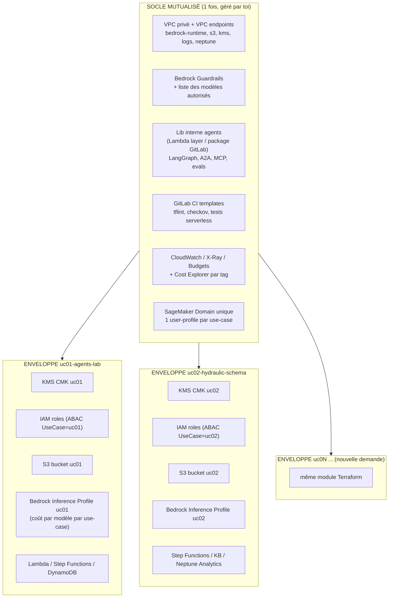
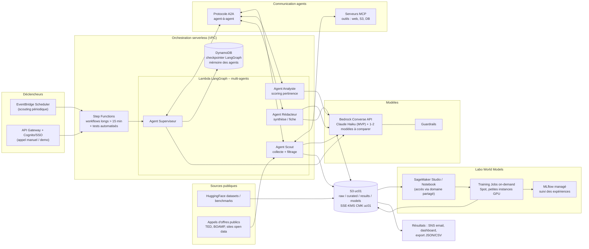
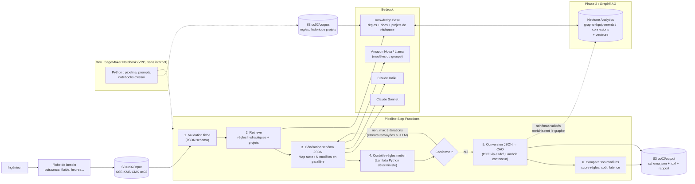

# Architecture AWS – Plateforme IA multi-use-cases (RAG / LangGraph / GraphRAG)

> Hypothèse : les deux repos locaux (`trends-analysis`, `langgraph-agents`) n'étaient pas accessibles
> depuis cette session ; l'architecture ci-dessous part des besoins décrits et réutilise le pattern
> « Lambda + LangGraph + Bedrock + S3 » déjà en place. À confronter avec le code existant.

Sommaire : 1. Principe d'optimisation · 2. Besoin 1 · 3. Besoin 2 · 4. Tagging · 5. Chiffrement · 6. Coûts / garde-fous · 7. Plan de mise en œuvre

---

## 1. Principe : « socle commun + enveloppe par use-case »

Chaque nouvelle demande métier = **un module Terraform `usecase-baseline`** instancié avec un nom
(`uc01-agents-lab`, `uc02-hydraulic-schema`, `uc03-...`). Le module crée **toujours** les mêmes
briques d'isolation, et le reste (Bedrock, Lambda, Neptune, SageMaker…) se branche dessus.

**Ce qu'on mutualise** (économie + cohérence) : VPC/endpoints, guardrails, bibliothèque LangGraph/agents,
templates CI, domaine SageMaker, dashboards, politique de tags.
**Ce qu'on isole** (sécurité + refacturation) : clé KMS, rôles IAM, bucket S3, inference profile Bedrock,
base graphe, logs. Aucune donnée ni clé partagée entre use-cases métiers.

---

## 2. Besoin 1 – Plateforme prototypage : multi-agents, protocoles, world models

Données : publiques / open source uniquement (HuggingFace, benchmarks) ; évolution possible vers S3 ENGIE.

Points clés :
- **Lambda** pour chaque agent/nœud ; **Step Functions** autour pour dépasser les 15 min, faire les retries et
  exécuter les **tests/évals serverless** (jeu de cas de test → agents → score → rapport S3).
- **A2A** (agent↔agent) et **MCP** (agent↔outils) exposés derrière des Lambda (Function URL / API GW privée).
  Alternative à évaluer plus tard : Bedrock AgentCore (runtime, gateway, mémoire managés).
- **Bedrock Haiku** par défaut ; changement de modèle = paramètre du module, pas de code.
- **World models** : pas de GPU permanent. Notebooks arrêtés automatiquement (idle shutdown), Training
  Jobs en Spot, modèles pré-existants d'abord ; dimensionnement GPU décidé après mesure sur petite échelle.
- **Composants réutilisables** : tout ce qui est dans `LIB` (graphes LangGraph génériques, wrapper Bedrock,
  adaptateur A2A/MCP, harness d'évaluation) est publié dans le registre GitLab et consommé par les autres use-cases.

---

## 3. Besoin 2 – Génération de schéma d'ingénierie hydraulique (LLM → JSON → CAO)

Choix recommandés (coût / simplicité) :
| Besoin exprimé | Proposition | Pourquoi |
|---|---|---|
| Plusieurs modèles Bedrock | **Converse API** + `Map` Step Functions | un seul code, comparaison objective (règles respectées, tokens, latence) |
| Notebook Python | **SageMaker Studio/Notebook** dans le domaine partagé, VPC only | accès Bedrock/S3/Neptune par endpoints privés |
| Contrôle des règles | **Code déterministe** (pas de LLM) + boucle de correction | fiabilité ; les règles hydrauliques deviennent des tests réutilisables |
| JSON → CAO | **DXF (ezdxf)** en premier, formats propriétaires ensuite | léger, scriptable ; convertisseur isolé = remplaçable |
| KB / RAG | **Bedrock Knowledge Bases**, vector store **S3 Vectors** (MVP) | évite le coût plancher d'OpenSearch Serverless |
| Graphe / GraphRAG | **Neptune Analytics** (intégré à Bedrock KB GraphRAG) en priorité ; **Neptune Database** seulement si besoin transactionnel/Gremlin | Analytics = création/suppression à la demande, pas de cluster à garder allumé |

Phasage : **Phase 1** = Fiche + règles (KB simple) → JSON → CAO, sans graphe.
**Phase 2** = ingestion de l'historique projets, bascule de la KB sur Neptune Analytics (GraphRAG).

---

## 4. Tagging – une taxonomie obligatoire

Appliquée via `default_tags` Terraform (impossible d'oublier) + **AWS Organizations Tag Policy** +
**Config rule / SCP** refusant la création sans tags obligatoires.

| Tag | Exemple | Obligatoire | Usage |
|---|---|---|---|
| `UseCase` | `uc02-hydraulic-schema` | oui | clé de refacturation + ABAC IAM |
| `BusinessUnit` / `CostCenter` | `engie-xxx` | oui | refacturation vers le métier |
| `Owner` | `prenom.nom` | oui | qui contacter |
| `Environment` | `dev` / `test` | oui | séparation |
| `DataClassification` | `public` / `internal` | oui | passe de `public` à `internal` quand on branche les données ENGIE |
| `Phase` | `prototype` / `mvp` | oui | priorisation / nettoyage |
| `ExpiryDate` | `2026-12-31` | prototypes | suppression automatique des ressources oubliées |
| `ManagedBy` | `terraform` | oui | traçabilité |

À faire côté facturation :
1. **Activer les tags en « cost allocation tags »** (Billing console) – 24 h de délai.
2. **Bedrock : utiliser des Application Inference Profiles taguées** (un par use-case et par modèle) ;
   sans cela, les appels Bedrock ne sont pas ventilables par tag. Les appels passent par l'ARN du profil.
3. **Un AWS Budget par `UseCase`** (alerte 80 % / 100 %) + Cost Anomaly Detection.
4. Rapport CUR/Athena ou Cost Explorer groupé par `UseCase`.

---

## 5. Chiffrement – une clé par use-case

| Couche | Mécanisme |
|---|---|
| S3 | SSE-KMS avec **CMK du use-case**, Bucket Keys activées, policy refusant `PutObject` sans chiffrement et tout accès non-TLS, Block Public Access |
| Bedrock KB / vector store | clé KMS du use-case (KB, ingestion jobs, S3 Vectors / Neptune Analytics) |
| Neptune / Neptune Analytics | chiffrement au repos avec CMK du use-case (**à définir à la création**, non modifiable après) |
| DynamoDB (checkpoints), SQS, SNS | CMK du use-case |
| SageMaker | `VolumeKmsKeyId` + `OutputKmsKeyId`, notebook en VPC, root access désactivé |
| Lambda | variables d'environnement chiffrées KMS ; secrets dans Secrets Manager (CMK use-case) |
| CloudWatch Logs | log groups chiffrés KMS, rétention limitée (pas de prompts sensibles en clair) |
| Transit | TLS 1.2+, VPC endpoints (PrivateLink) pour Bedrock/S3/KMS |

**Isolation par clé** : la key policy n'autorise que les rôles portant `aws:PrincipalTag/UseCase = <ce use-case>`
(ABAC). Résultat : même si un rôle d'un autre use-case a des droits S3 trop larges, il ne peut pas déchiffrer.
Chaque clé a un alias `alias/uc02-hydraulic-schema-dev`, rotation annuelle activée.

Exemple prêt à l'emploi : `terraform/modules/usecase-baseline/`.

---

## 6. Optimisation coûts et opérations

- **Serverless + à la demande** partout : Lambda, Step Functions, Bedrock on-demand ; pas de ressource
  permanente coûteuse (OpenSearch Serverless évité, Neptune Analytics supprimable/restaurable depuis snapshot).
- **Notebooks / Studio** : arrêt auto sur inactivité (lifecycle config), un seul domaine SageMaker.
- **Modèles** : Haiku par défaut ; Sonnet seulement dans la comparaison ; prompt caching Bedrock pour les
  longs prompts de règles ; limiter `max_tokens`.
- **`ExpiryDate`** + job nocturne qui alerte puis supprime les ressources de prototypes expirées.
- **Un seul pipeline CI** (templates GitLab) : `terraform fmt/validate`, `tflint`, `checkov` (DevSecOps),
  tests serverless Step Functions, déploiement par use-case via variable `use_case`.
- **Accès** : ABAC (`UseCase`) plutôt qu'un rôle par personne ; SSO IAM Identity Center avec permission set par use-case.

---

## 7. Plan de mise en œuvre (ordre conseillé)

1. Socle : VPC endpoints, politique de tags, Budgets, domaine SageMaker, guardrails.
2. Module `usecase-baseline` (KMS, S3, rôles ABAC, inference profiles, budget) – testé sur `uc01`.
3. Reprendre dans la lib commune ce qui existe déjà dans `langgraph-agents` (wrapper Bedrock, checkpointer, déploiement Lambda).
4. `uc02` Phase 1 : pipeline Step Functions + validation règles + DXF ; comparaison de modèles.
5. `uc01` : agents scout/analyste + A2A/MCP ; labo world models dans SageMaker.
6. `uc02` Phase 2 : Knowledge Base + Neptune Analytics (GraphRAG).
