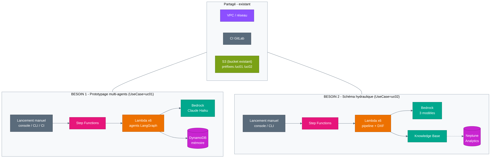
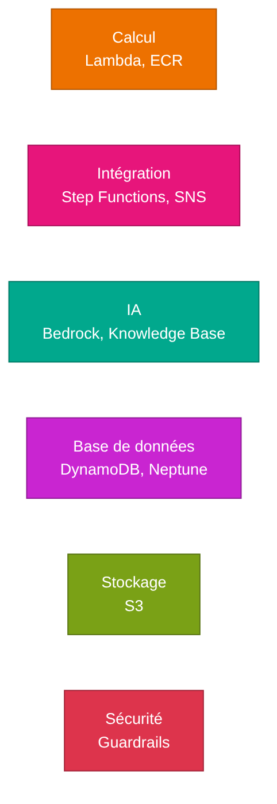
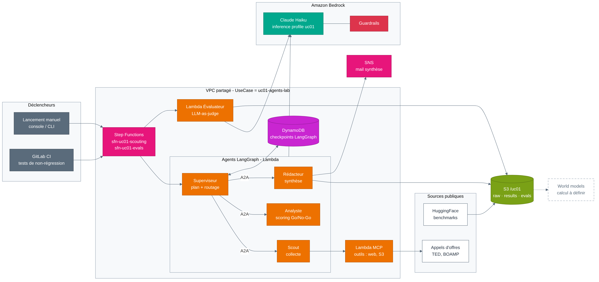
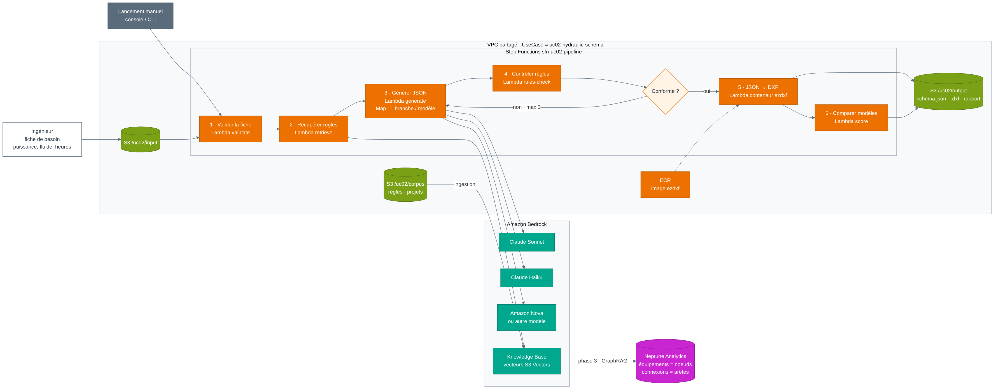

# Besoins 1 et 2 – ressources AWS à créer et benchmark

**Partagé (existant, rien à créer) :** VPC / réseau, CI GitLab, bucket S3 (un préfixe par besoin).
**Pas de SageMaker. Pas de module Terraform commun :** chaque besoin a ses propres ressources, taguées `UseCase`.

---

## Benchmark des deux besoins

| | **Besoin 1 – Prototypage multi-agents** | **Besoin 2 – Schéma hydraulique** |
|---|---|---|
| Tag | `UseCase=uc01-agents-lab` | `UseCase=uc02-hydraulic-schema` |
| Objectif | Prototyper des agents qui coopèrent (scouting, appels d'offres), tester les protocoles A2A / MCP, explorer les world models | Vérifier qu'un LLM génère un schéma hydraulique JSON → CAO à partir d'une fiche de besoin et de règles métier |
| Nature | Exploratoire, plusieurs prototypes | Faisabilité ciblée, résultat mesurable (Go / No-Go) |
| Données | Publiques uniquement (HuggingFace, TED, BOAMP) | Fiches d'essai, règles hydrauliques, puis historique de projets |
| Modèles Bedrock | 1 (Claude Haiku), + 1 en comparaison | 3 en parallèle (Sonnet, Haiku, Nova ou autre) |
| Orchestration | Step Functions + agents LangGraph sur Lambda | Step Functions (pipeline en 6 étapes, boucle de correction) |
| Déclenchement (dev) | Manuel (console / CLI) + CI pour les tests | Manuel (console / CLI, chemin de la fiche en entrée) |
| Mémoire / état | DynamoDB (checkpoints LangGraph) | Aucun (pipeline sans état) |
| RAG | Non | Oui – Bedrock Knowledge Base (phase 2) |
| Graphe | Non | Oui – Neptune Analytics / GraphRAG (phase 3) |
| Sortie | Synthèse par mail (SNS) + résultats S3 | `schema.json` + `.dxf` + rapport comparatif des modèles |
| Nb de ressources à créer | ~18 | ~14 (phase 1), ~21 (avec phases 2 et 3) |
| Coût estimé | **≈ 130 – 160 $/mois** | **≈ 75 $/mois** (phase 1) → **≈ 180 – 450 $/mois** (avec Neptune) |
| Point ouvert | Calcul pour les world models (SageMaker exclu) | Environnement de dev : en local avec accès Bedrock |

---

## Besoin 1 – Prototypage multi-agents (`uc01-agents-lab`)

**Fonctionnement :** le workflow Step Functions est lancé manuellement (console ou CLI) pendant le dev. Le superviseur répartit le travail
entre trois agents (A2A) : le scout collecte les appels d'offres publics via un serveur MCP, l'analyste les note,
le rédacteur produit une synthèse envoyée par mail et stockée dans S3. Un second workflow rejoue un jeu de cas de
test et note les réponses (LLM-as-judge), déclenché par la CI.

### Ressources à créer

| Service | Ressource | Nb | Rôle |
|---|---|---|---|
| Lambda | `uc01-supervisor`, `uc01-scout`, `uc01-analyst`, `uc01-writer` | 4 | Agents LangGraph |
| Lambda | `uc01-mcp-tools` | 1 | Serveur MCP : outils web fetch, lecture/écriture S3 |
| Lambda | `uc01-evaluator` | 1 | Évaluation automatique des réponses |
| Step Functions | `sfn-uc01-scouting`, `sfn-uc01-evals` | 2 | Workflow de scouting + campagne de tests |
| DynamoDB | `uc01-agent-checkpoints` (on-demand) | 1 | Mémoire / état des agents LangGraph |
| Bedrock | Accès Claude Haiku (+ 1 modèle de comparaison) | 1–2 | LLM des agents |
| Bedrock | Application inference profile tagué `uc01` | 1–2 | Rend le coût Bedrock attribuable au besoin |
| Bedrock | Guardrail | 1 | Filtrage contenu / PII |
| SNS | `uc01-notifications` | 1 | Envoi de la synthèse |
| S3 | Préfixe `/uc01/` (raw, results, evals) | – | Dans le bucket partagé |
| IAM | Rôle Lambda, rôle Step Functions | 2 | Moindre privilège, limités au préfixe `/uc01/` |
| CloudWatch | Log groups (rétention 30 j) + 1 alarme d'erreurs | ~7 | Supervision |
| Budget | Budget filtré sur `UseCase=uc01-agents-lab` | 1 | Alerte coût |
| **À définir** | Calcul world models | – | SageMaker exclu : à cadrer avec le demandeur |

### Coût estimé (≈ 130 – 160 $/mois)

| Poste | Hypothèse | $/mois |
|---|---|---|
| Bedrock Haiku – scouting | 100 appels d'offres/jour × 4 appels × (4k in + 0,8k out) | ≈ 100 |
| Bedrock – évaluations | 500 cas/mois × 2 modèles + juge | 20 – 40 |
| Lambda, Step Functions, DynamoDB, SNS | faible volume | < 10 |
| S3, CloudWatch | | ≈ 5 |

---

## Besoin 2 – Génération de schémas hydrauliques (`uc02-hydraulic-schema`)

**Fonctionnement :** l'ingénieur dépose une fiche de besoin dans S3. Le pipeline Step Functions, lancé manuellement pendant le dev, la valide, récupère
les règles hydrauliques, fait générer le schéma JSON par 3 modèles en parallèle, contrôle chaque résultat avec les
règles métier (code Python, pas de LLM) et renvoie les erreurs au modèle jusqu'à 3 fois. Les schémas conformes sont
convertis en DXF, puis un rapport compare les modèles (règles respectées, itérations, coût, latence).

### Ressources à créer

**Phase 1 – faisabilité (règles passées directement dans le prompt)**

| Service | Ressource | Nb | Rôle |
|---|---|---|---|
| Step Functions | `sfn-uc02-pipeline` | 1 | Pipeline en 6 étapes + boucle de correction |
| Lambda | `uc02-validate`, `uc02-retrieve`, `uc02-generate`, `uc02-rules-check`, `uc02-score` | 5 | Étapes du pipeline |
| Lambda (conteneur) | `uc02-json-to-dxf` | 1 | Conversion CAO avec `ezdxf` |
| ECR | `uc02-dxf-converter` | 1 | Image de la Lambda de conversion |
| Bedrock | Accès Sonnet, Haiku, Nova (ou modèles du groupe) | 3 | Comparaison des modèles |
| Bedrock | Application inference profiles tagués `uc02` | 3 | Coût par modèle et par besoin |
| S3 | Préfixes `/uc02/input`, `/uc02/corpus`, `/uc02/output` | – | Dans le bucket partagé |
| IAM | Rôle Lambda, rôle Step Functions | 2 | Limités au préfixe `/uc02/` |
| CloudWatch | Log groups + alarme d'erreurs | ~8 | Supervision |
| Budget | Budget filtré sur `UseCase=uc02-hydraulic-schema` | 1 | Alerte coût |

**Phase 2 – base de connaissance (quand le corpus dépasse ce qu'on peut mettre dans le prompt)**

| Service | Ressource | Nb | Rôle |
|---|---|---|---|
| Bedrock | Knowledge Base `uc02-kb` + data source `/uc02/corpus` | 1 | RAG sur règles et projets de référence |
| S3 Vectors | Vector bucket + index | 1 | Stockage des vecteurs (le moins cher) |
| Bedrock | Accès modèle d'embeddings (Titan Text Embeddings v2) | 1 | Vectorisation du corpus |
| IAM | Rôle de service de la Knowledge Base | 1 | Lecture du corpus, écriture des vecteurs |

**Phase 3 – graphe / GraphRAG (quand l'historique de projets est prêt)**

| Service | Ressource | Nb | Rôle |
|---|---|---|---|
| Neptune Analytics | Graphe `uc02-graph` (plus petite capacité) | 1 | Équipements = nœuds, connexions = arêtes |
| Bedrock | Knowledge Base configurée en GraphRAG sur Neptune Analytics | – | Remplace / complète S3 Vectors |
| Neptune Analytics | Snapshot | 1 | Supprimer le graphe hors usage et le restaurer |

### Coût estimé

| Poste | Hypothèse | $/mois |
|---|---|---|
| Bedrock – génération | 300 essais/mois × 3 modèles × 1,5 itération × (12k in + 3k out) | ≈ 60 |
| Lambda, Step Functions, ECR | | < 10 |
| S3, CloudWatch | | ≈ 5 |
| **Total phase 1** | | **≈ 75** |
| Knowledge Base + S3 Vectors + embeddings (phase 2) | corpus < 10 Go | < 10 |
| Neptune Analytics (phase 3) | ≈ 0,5 $/h : 24/7 ≈ 350 $ · heures ouvrées ≈ 90 $ | 90 – 350 |
| Ingestion GraphRAG (phase 3) | extraction d'entités par LLM, ponctuelle | 10 – 50 / ingestion |

---

## Benchmark des choix techniques

**Orchestration des agents (besoin 1)**

| Option | + | – | Choix |
|---|---|---|---|
| Lambda seule | Simple, déjà utilisé dans LangGraph Agents | Limite de 15 min, pas de reprise sur erreur | |
| **Step Functions + Lambda** | Workflows longs, retries, parallélisme, tests rejouables | Une ressource de plus à gérer | ✅ |
| Bedrock AgentCore | Runtime, mémoire et gateway MCP managés | Plus récent, moins de recul | à évaluer plus tard |

**Stockage des vecteurs (besoin 2)**

| Option | Coût mini | Remarque | Choix |
|---|---|---|---|
| **S3 Vectors** | ≈ quelques $/mois | Le moins cher, suffisant pour un prototype | ✅ phase 2 |
| OpenSearch Serverless | ≈ 175 – 350 $/mois | Coût plancher même sans trafic | ❌ |
| Neptune Analytics | ≈ 90 – 350 $/mois | Vecteurs + graphe, nécessaire pour le GraphRAG | ✅ phase 3 |

**Base graphe (besoin 2)**

| Option | + | – | Choix |
|---|---|---|---|
| **Neptune Analytics** | Intégré au GraphRAG des Knowledge Bases, supprimable/restaurable | Facturé à l'heure tant qu'il existe | ✅ |
| Neptune Database | Transactionnel, Gremlin / openCypher | Cluster permanent, plus cher et plus lourd | si besoin transactionnel |

**Modèles (besoin 2)**

| Modèle | Prix approx. (M tokens in / out) | Rôle dans le benchmark |
|---|---|---|
| Claude Sonnet | 3 $ / 15 $ | Référence qualité |
| Claude Haiku | 1 $ / 5 $ | Compromis coût / qualité |
| Amazon Nova Pro (ou modèle du groupe) | 0,8 $ / 3,2 $ | Option la moins chère |

> Tarifs et coûts : ordres de grandeur sur prix publics on-demand, à recalculer avec l'AWS Pricing Calculator
> pour la région et les modèles réellement ouverts sur le compte.

---

## Ordre de mise en place

> Phase de dev : pas d'EventBridge, les workflows sont lancés à la main
> (`aws stepfunctions start-execution`) ou par la CI. Un déclencheur automatique (planification ou dépôt S3)
> pourra être ajouté quand le prototype passera en usage régulier.

1. **Besoin 1 – MVP** : Step Functions + superviseur, scout, rédacteur + DynamoDB (reprend le pattern
   Lambda + LangGraph existant). Puis analyste, A2A / MCP et évaluations.
2. **Besoin 2 – Phase 1** : pipeline Step Functions, 3 modèles, contrôle des règles, DXF → décision Go / No-Go.
3. **Besoin 2 – Phase 2** : Knowledge Base + S3 Vectors si la phase 1 est concluante.
4. **Besoin 2 – Phase 3** : Neptune Analytics quand l'historique de projets est prêt.

Avant tout : activer `UseCase` en *cost allocation tag* dans Billing (non rétroactif).
